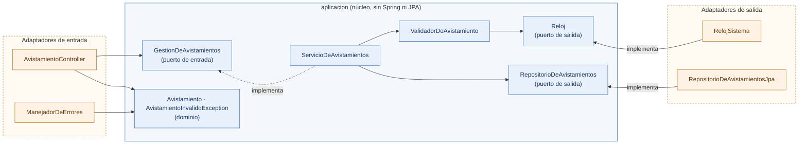
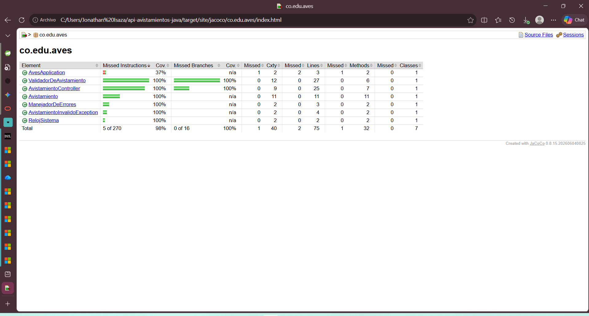
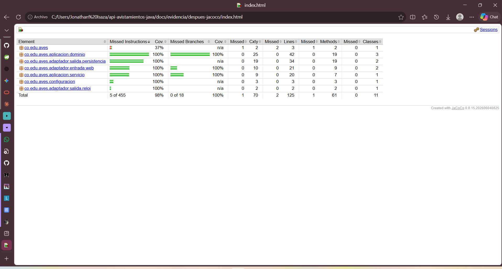

# Taller 5: Clean Architecture y arquitectura hexagonal

**Curso:** Ingeniería de Software 2 (ISW-2), Universidad El Bosque. **Fecha:** miércoles 11 de noviembre de 2026.
**Estudiante:** Pablo. **Trabajo:** individual, sobre mi API de avistamientos de aves (Java, Spring Boot).

| Dato | Valor |
|---|---|
| Repositorio | <https://github.com/pabloCastro1532/api-avistamientos-java> |
| Rama del refactor | `refactor-arquitectura` (<https://github.com/pabloCastro1532/api-avistamientos-java/tree/refactor-arquitectura>) |
| Historial de commits de la rama | <https://github.com/pabloCastro1532/api-avistamientos-java/commits/refactor-arquitectura> |
| Arquitectura elegida | Hexagonal (puertos y adaptadores) |

---

# Parte 1. Investigación

## 1. El problema de Cockburn, puertos, adaptadores y simetría

**El problema.** Cockburn ve que en las aplicaciones de su época la lógica de negocio se cuela en el código de la interfaz de usuario. Eso trae tres consecuencias: la lógica queda atada a detalles visuales (tamaño de campos, posición de botones) y no se puede probar de forma automática; no se puede ejecutar por lotes sin pantalla; y otros programas no pueden usarla (Cockburn, 2005). Agregar una capa más no lo arregla, porque nada avisa cuando alguien rompe la promesa de no meter lógica en la interfaz, y la lógica vuelve a filtrarse. Del lado de los datos pasa algo parecido: si la lógica está pegada a la base, el desarrollo se frena cuando el servidor de base de datos está caído o se está reemplazando (Cockburn, 2005). Para él las dos cosas tienen la misma raíz: mezclar la lógica de negocio con la interacción con entidades externas.

**Puerto y adaptador.** Un puerto es el punto por donde la aplicación mantiene una "conversación con propósito" con el exterior (por ejemplo, "gestionar avistamientos"), y se expresa como una API. Un adaptador es la pieza que traduce entre esa API y las señales que necesita cada dispositivo o tecnología concreta (Cockburn, 2005). En mi API, `GestionDeAvistamientos` es un puerto y `AvistamientoController` es el adaptador que convierte una petición HTTP en una llamada a ese puerto.

**La simetría.** Cockburn dice que la asimetría importante no es izquierda contra derecha (usuario contra base de datos), sino *dentro* contra *fuera* de la aplicación. Como la interfaz y la base de datos son cosas externas que se alcanzan por puertos, se pueden tratar de forma parecida: la misma aplicación puede ser manejada por una interfaz gráfica, por un conjunto de pruebas o por un script por lotes, y puede usar una base real o una simulada (Cockburn, 2005). Eso no significa que sean idénticos: él distingue actores primarios (los que manejan a la aplicación, lado del usuario) y secundarios (los que la aplicación maneja, lado de la base de datos) (Cockburn, 2005). La simetría está en cómo se conectan, no en qué hacen.

## 2. Los círculos de Martin y la regla de dependencia

Martin dibuja cuatro círculos, de adentro hacia afuera (Martin, 2012):

1. **Entidades:** reglas de negocio de toda la empresa (o los objetos centrales de la aplicación, si no hay "empresa"). Son lo que menos cambia cuando cambia algo externo.
2. **Casos de uso:** reglas de negocio propias de la aplicación. Coordinan el flujo de datos desde y hacia las entidades, y no saben nada de base de datos, interfaz ni frameworks.
3. **Adaptadores de interfaz:** convierten los datos entre la forma cómoda para los casos de uso y la cómoda para lo externo. Aquí viven controladores y presentadores, y aquí queda confinado el SQL.
4. **Frameworks y drivers:** la base de datos, el framework web y demás herramientas. Casi no tiene código propio, solo el pegamento hacia el círculo de adentro.

**La regla de dependencia.** Las dependencias del código fuente solo pueden apuntar hacia adentro. Lo prohibido es que algo de un círculo interno conozca algo de uno externo: no puede mencionar nombres de clases, funciones o variables declaradas afuera, ni usar formatos de datos que vengan de afuera, sobre todo los generados por un framework. Los datos que cruzan una frontera deben ser estructuras simples (no entidades ni filas de base de datos) y con la forma que le conviene al círculo interno (Martin, 2012). Martin aclara además que los cuatro círculos son un esquema y que el número no es fijo: la regla se mantiene aunque haya más.

*Aplicado a mi API original:* mi clase `Avistamiento` llevaba `@Entity` y `@Id` de Jakarta Persistence. Eso es un nombre declarado afuera usado adentro, así que violaba la regla.

## 3. Cómo se resuelve "el caso de uso necesita guardar pero no puede depender de la base"

El conflicto aparece porque el flujo de ejecución va del caso de uso hacia la base de datos, pero las dependencias del código fuente tienen que apuntar hacia adentro. Martin lo resuelve con el principio de inversión de dependencias: el caso de uso no llama a la implementación externa, sino a una interfaz que se declara *dentro de su propio círculo*, y el círculo externo implementa esa interfaz. Al ejecutar, el polimorfismo hace que la llamada llegue a la implementación de afuera, pero en el código fuente la dependencia queda invertida respecto al flujo de control (Martin, 2012). Martin lo ilustra con el presentador y un "puerto de salida del caso de uso"; es el mismo mecanismo que sirve para la base de datos. Palermo lo plantea igual para la persistencia: las interfaces del repositorio viven en el núcleo, las implementaciones en la capa externa, y se inyectan en tiempo de ejecución (Palermo, 2008).

**Ejemplo en mi API (crear un avistamiento):**

- `ServicioDeAvistamientos.crear(...)` valida y luego llama a `repositorio.guardar(...)`.
- `repositorio` es de tipo `RepositorioDeAvistamientos`, una interfaz declarada en `aplicacion/puerto/salida`, dentro del núcleo.
- `RepositorioDeAvistamientosJpa`, en `adaptador/salida/persistencia`, implementa esa interfaz con Spring Data y H2. El `import` va del adaptador hacia el núcleo, nunca al revés.
- `ConfiguracionDeBeans` conecta ambos al arrancar.
- Prueba de que el servicio no sabe qué hay detrás: en `ServicioDeAvistamientosTest` lo conecto a un `RepositorioEnMemoria` (un fake) y funciona igual, sin Spring ni base de datos.

## 4. Hexagonal, cebolla y Clean Architecture: qué tienen en común y qué cambia

**En común.** Martin dice que estas arquitecturas difieren en los detalles pero comparten un objetivo, separar responsabilidades dividiendo el software en capas, con al menos una capa para las reglas de negocio y otra para las interfaces. Los sistemas así resultan independientes de frameworks, de la interfaz y de la base de datos, y se pueden probar sin ellos (Martin, 2012). Palermo conecta su propuesta con la hexagonal: las dos sacan la infraestructura hacia el borde detrás de interfaces (Palermo, 2008). En las tres, la dependencia apunta hacia las reglas de negocio.

**Qué cambia.**

| | Hexagonal (Cockburn, 2005) | Cebolla (Palermo, 2008) | Clean Architecture (Martin, 2012) |
|---|---|---|---|
| Vocabulario | Puertos, adaptadores, actores primarios y secundarios | Modelo de dominio al centro; interfaces de repositorio en el primer anillo; UI, infraestructura y pruebas afuera | Entidades, casos de uso, adaptadores de interfaz, frameworks y drivers |
| Capas | No define anillos: separa *dentro* y *fuera* y pone un puerto por cada conversación | Anillos alrededor del dominio; su número varía | Cuatro círculos, pero dice que el número no es fijo |
| Énfasis | Que varios tipos de actores (usuario, pruebas, lotes) manejen la misma aplicación y que la base se pueda simular | Crítica a la arquitectura en capas clásica, donde la UI depende de la base aunque sea de forma transitiva; "la base de datos es externa" | Una regla única y explícita (la de dependencia), más cómo deben cruzar los datos las fronteras |
| Granularidad interna | No dice cómo dividir el interior | Modelo de dominio y capas de comportamiento alrededor | Separa entidades (reglas generales) de casos de uso (reglas de la aplicación) |

*Mi lectura (no es de las fuentes):* la idea de fondo es la misma, y lo que más cambia es el vocabulario y qué tan fino se divide el interior. Por eso es coherente elegir una y usar sus nombres de forma consistente, sin mezclar.

## 5. ¿Se justifica en una API tan pequeña?

**Mi posición:** para esta API tal como está, y si se va a quedar así, el costo supera el beneficio. Se justifica si se espera que crezca (más reglas, otro canal de entrada además de HTTP, o cambiar H2 por otra base). Aquí lo apliqué porque el taller lo pide y porque me sirvió para ver qué se gana.

**Costo concreto.** El código de `src/main` pasó de 9 a 15 archivos. Hubo que duplicar el modelo: `Avistamiento` (dominio) y `AvistamientoJpa` (persistencia), con dos métodos que copian campo por campo entre ambos. Además, para entender el recorrido de un `PUT` ahora hay que abrir el controlador, el puerto, el servicio y el adaptador JPA, y el orden "primero 400, después 404" quedó repartido entre el servicio y el controlador. Palermo mismo advierte que su arquitectura no es apropiada para sitios pequeños y sí para aplicaciones de negocio longevas y con comportamiento complejo (Palermo, 2008).

**Beneficio concreto.** Los casos de uso ahora se prueban sin levantar Spring ni base de datos. Las 15 pruebas de `ServicioDeAvistamientosTest` corrieron en 0,123 s, mientras que `AvesApplicationTests` (que arranca el contexto de Spring) tardó 9,0 s y las 14 pruebas de integración 2,3 s (salida de `docs/evidencia/despues-pruebas.txt`). Eso es lo que Cockburn busca: poder construir y probar la aplicación aislada de sus dispositivos y bases de datos (Cockburn, 2005). Además, la base se puede cambiar escribiendo un adaptador nuevo, sin tocar las reglas (Martin, 2012; Palermo, 2008).

---

# Parte 2. Aplicación

## Qué arquitectura elegí y por qué

Elegí la **arquitectura hexagonal**. Mis razones: (a) mi API tiene exactamente dos lados claros, la web y la base de datos, y el vocabulario de puertos y adaptadores describe eso sin forzar nada; (b) la cebolla y Clean Architecture piden más anillos o separar entidades de casos de uso, y con una sola regla de negocio esa separación no aporta; (c) la intención de Cockburn de que la aplicación pueda ser manejada por pruebas se cumple de forma directa (Cockburn, 2005): `ServicioDeAvistamientosTest` es un "actor primario" más.

Para ser consistente uso solo vocabulario hexagonal: `aplicacion` es el hexágono, `puerto/entrada` y `puerto/salida` son los puertos, y todo lo que toca una tecnología vive en `adaptador/entrada` o `adaptador/salida`. Una concesión: el adaptador web se sigue llamando `Controller` porque es la convención de Spring.

## Estructura de carpetas

```
src/main/java/co/edu/aves/
├── AvesApplication.java
├── aplicacion/                  <- el hexágono (sin Spring ni JPA)
│   ├── dominio/
│   │   ├── Avistamiento.java
│   │   ├── AvistamientoInvalidoException.java
│   │   └── ValidadorDeAvistamiento.java
│   ├── puerto/
│   │   ├── entrada/
│   │   │   └── GestionDeAvistamientos.java
│   │   └── salida/
│   │       ├── RepositorioDeAvistamientos.java
│   │       └── Reloj.java
│   └── servicio/
│       └── ServicioDeAvistamientos.java
├── adaptador/
│   ├── entrada/web/
│   │   ├── AvistamientoController.java
│   │   └── ManejadorDeErrores.java
│   └── salida/
│       ├── persistencia/
│       │   ├── AvistamientoJpa.java
│       │   ├── AvistamientoJpaRepository.java
│       │   └── RepositorioDeAvistamientosJpa.java
│       └── reloj/
│           └── RelojSistema.java
└── configuracion/
    └── ConfiguracionDeBeans.java    <- raíz de composición

src/test/java/co/edu/aves/
├── AvesApplicationTests.java
├── AvistamientoApiIntegrationTest.java
├── ValidadorDeAvistamientoTest.java
├── RelojFijo.java               <- stub del reloj
└── aplicacion/servicio/
    ├── ServicioDeAvistamientosTest.java
    └── RepositorioEnMemoria.java  <- fake del puerto de salida
```

Qué es cada parte: `puerto/entrada` son los casos de uso que la aplicación ofrece; `puerto/salida` es lo que la aplicación necesita del exterior (guardar datos y saber la fecha de hoy); los adaptadores traducen entre esos puertos y las tecnologías (HTTP, JPA/H2, reloj del sistema).

## Diagrama de la dirección de las dependencias

Las flechas son dependencias del **código fuente** (quién importa a quién).



El mismo diagrama, clase por clase (`A --> B` significa "A depende de B"):

```
Adaptadores de entrada hacia el núcleo
  AvistamientoController --> GestionDeAvistamientos (puerto)
  AvistamientoController --> Avistamiento (dominio)
  ManejadorDeErrores --> AvistamientoInvalidoException (dominio)

Dentro del núcleo
  ServicioDeAvistamientos --> GestionDeAvistamientos (la implementa)
  ServicioDeAvistamientos --> RepositorioDeAvistamientos (puerto)
  ServicioDeAvistamientos --> ValidadorDeAvistamiento
  ValidadorDeAvistamiento --> Reloj (puerto)

Adaptadores de salida hacia el núcleo
  RepositorioDeAvistamientosJpa --> RepositorioDeAvistamientos
  RelojSistema --> Reloj

Raíz de composición
  ConfiguracionDeBeans --> todo lo anterior (conoce ambos lados)
```

Lo que **no existe** (lo prohíbe la regla de dependencia): ninguna flecha del núcleo hacia un adaptador, ni hacia Spring o Jakarta.

Lectura del diagrama:

- Todas las flechas de código fuente apuntan hacia el núcleo o están dentro de él. Se comprueba con este comando, que no imprime nada:
  `findstr /s /i /m "springframework jakarta" src\main\java\co\edu\aves\aplicacion\*.java`
- En ejecución, la llamada sí sale hacia afuera (servicio, puerto, adaptador, base de datos). Esa es la inversión de dependencias del punto 3 de la Parte 1.

## Cómo fue evolucionando (commits de la rama)

| # | Commit | Qué cambia | Estado de las pruebas |
|---|---|---|---|
| 0 | Evidencia "antes": pruebas, cobertura y muestra de la API | Se guarda la línea base sin tocar el código | 30 de 30 pasan |
| 1 | Hexagonal 1/3: crear el núcleo (dominio, puertos y casos de uso) | Se agrega `aplicacion/` junto al código viejo; todavía nada lo usa | 30 de 30 pasan |
| 2 | Hexagonal 2/3: adaptadores web, JPA y reloj; configuración de beans | Se crean los adaptadores, se borran las 8 clases viejas y las pruebas pasan a usar el puerto | 30 de 30 pasan |
| 3 | Hexagonal 3/3: pruebas del servicio con fake en memoria | Se agregan 15 pruebas de los casos de uso sin Spring | 45 de 45 pasan |
| 4 | Evidencia "después" y este documento | Salida de pruebas, cobertura y muestra de la API | 45 de 45 pasan |

Hice el cambio en ese orden (primero el núcleo al lado del código viejo, luego el cambio de los adaptadores) para que las pruebas del taller anterior estuvieran en verde en cada commit.

## Evidencia antes y después

### Pruebas

| | Antes | Después |
|---|---|---|
| Pruebas totales | 30 | 45 |
| `ValidadorDeAvistamientoTest` | 15 | 15 |
| `AvistamientoApiIntegrationTest` | 14 | 14 |
| `AvesApplicationTests` | 1 | 1 |
| `ServicioDeAvistamientosTest` | no existía | 15 |
| Fallos / errores | 0 / 0 | 0 / 0 |
| Resultado | BUILD SUCCESS | BUILD SUCCESS |

Salidas completas: `docs/evidencia/antes-pruebas.txt` y `docs/evidencia/despues-pruebas.txt` (comando: `mvnw.cmd clean verify`). Las 30 pruebas anteriores no cambiaron de lógica: solo cambiaron los `import` y, en la de integración, el repositorio que usan para preparar datos (ahora el puerto `RepositorioDeAvistamientos` en vez de Spring Data directamente).

### Cobertura (JaCoCo 0.8.15)

| | Antes | Después |
|---|---|---|
| Instrucciones | 98 % (5 de 270 sin cubrir) | 98 % (5 de 455 sin cubrir) |
| Ramas | 100 % (0 de 16 sin cubrir) | 100 % (0 de 18 sin cubrir) |
| Clases | 7 | 11 |

Lo único sin cubrir en los dos momentos es el método `main` de `AvesApplication`, que solo arranca Spring; no vale la pena una prueba para eso.

Antes (`docs/evidencia/antes-jacoco/index.html`):



Después (`docs/evidencia/despues-jacoco/index.html`):



### La API responde igual

Corrí el mismo script (`docs/evidencia/muestra-api.bat`, 9 peticiones con `curl`) con la API arrancada antes y después, y comparé con `fc docs\evidencia\antes-api.txt docs\evidencia\despues-api.txt`.

| # | Petición | Esperado | Antes | Después |
|---|---|---|---|---|
| 1 | `GET /avistamientos` | 200 | 200 | 200 |
| 2 | `POST` válido | 201 | 201 | 201 |
| 3 | `POST` especie de 2 letras | 400, campo `especie` | 400, "La especie debe tener entre 3 y 50 caracteres" | igual |
| 4 | `POST` fecha futura | 400, campo `fecha` | 400, "La fecha no puede ser posterior a hoy" | igual |
| 5 | `POST` con campos faltantes | 400, campo `fecha` | 400, "El campo fecha no puede estar vacío" | igual |
| 6 | `GET /avistamientos/9999` | 404 | 404 | 404 |
| 7 | `PUT /avistamientos/9999` | 404 | 404 | 404 |
| 8 | `DELETE /avistamientos/9999` | 404 | 404 | 404 |
| 9 | `GET /avistamientos/resumen` | 200 | 200 | 200 |

`fc` mostró solo dos diferencias, y ninguna es de comportamiento:

- **El `id` del POST válido** (10 antes, 11 después), porque la base de datos de archivo ya tenía datos y el contador sigue creciendo.
- **El orden de las claves en los mensajes 400** (`campo`/`mensaje`). Un objeto JSON no tiene orden, y el orden lo decide `Map.of`, que varía en cada arranque de la JVM. Pasaba igual en el código original: no lo causó el refactor.

Muestra del POST válido, antes y después:

```
antes:
{"especie":"colibri","fecha":"2026-10-11","id":10,
 "lugar":"Chicaque","observador":"Pablo"}   HTTP 201
después:
{"especie":"colibri","fecha":"2026-10-11","id":11,
 "lugar":"Chicaque","observador":"Pablo"}   HTTP 201
```

## Lo más difícil de separar y por qué

Lo más difícil fue **`Avistamiento`**, porque era dos cosas en una sola clase: el concepto del negocio y la fila de la tabla (`@Entity`, `@Id`, `@GeneratedValue`). En mi código original nunca había notado esa mezcla. Separarlo obligó a decidir qué era de quién: el dominio se quedó con una clase simple (`Avistamiento`) y la persistencia con otra (`AvistamientoJpa`, que conserva `@Table(name = "avistamiento")` para no romper los datos que ya había en el archivo de H2), más dos métodos que traducen entre las dos. Es duplicación real, y es el costo más claro del refactor (punto 5 de la Parte 1).

Otras dos separaciones menos obvias:

- **Dónde vive cada decisión del controlador.** El controlador original validaba, preguntaba si el id existía y elegía el código HTTP, todo junto. Ahora el servicio decide "existe o no" y devuelve `Optional` o `boolean`, y el controlador solo traduce eso a 200, 204 o 404. Tuve que cuidar que `PUT` siguiera validando antes de buscar (400 antes que 404); hay una prueba del servicio para eso.
- **Cómo crear objetos del núcleo sin anotaciones.** `ServicioDeAvistamientos` y `ValidadorDeAvistamiento` ya no llevan `@Service` ni `@Component`, para que el núcleo no importe Spring. Alguien tiene que construirlos, y por eso apareció `ConfiguracionDeBeans`, la raíz de composición.

**Una limitación que dejé a propósito:** el controlador devuelve y recibe directamente la clase de dominio `Avistamiento` como JSON. Una versión más estricta usaría una clase aparte para el JSON (un DTO), para que el contrato de la API no dependa del dominio. No lo hice para no cambiar lo que responde la API y mantener la comparación del "antes y después" limpia, pero con eso el borde web todavía conoce la forma del dominio.

## Cómo reproducir

```
git checkout refactor-arquitectura
mvnw.cmd test               (pruebas)
mvnw.cmd clean verify       (pruebas + cobertura)
mvnw.cmd spring-boot:run    (arrancar la API en el puerto 8080)
docs\evidencia\muestra-api.bat   (muestra, con la API arrancada)
```

El reporte de cobertura queda en `target\site\jacoco\index.html`.

## Nota sobre el uso de IA

Usé Claude (Sonnet 5.5) como asistente durante el taller: para proponer el diseño hexagonal, generar el código de los commits 1 a 3 y un borrador de este documento. Yo ejecuté cada paso en mi equipo, corrí las pruebas y la cobertura, y revisé los resultados.

---

# Referencias

- Cockburn, A. (2005). *Hexagonal architecture*. <https://alistair.cockburn.us/hexagonal-architecture/> (consultado el 11 de noviembre de 2026).
- Martin, R. C. (2012, 13 de agosto). *The Clean Architecture*. Clean Coder Blog. <https://blog.cleancoder.com/uncle-bob/2012/08/13/the-clean-architecture.html> (consultado el 11 de noviembre de 2026).
- Palermo, J. (2008, julio). *The Onion Architecture: part 1*. <https://jeffreypalermo.com/2008/07/the-onion-architecture-part-1/> (consultado el 11 de noviembre de 2026).
