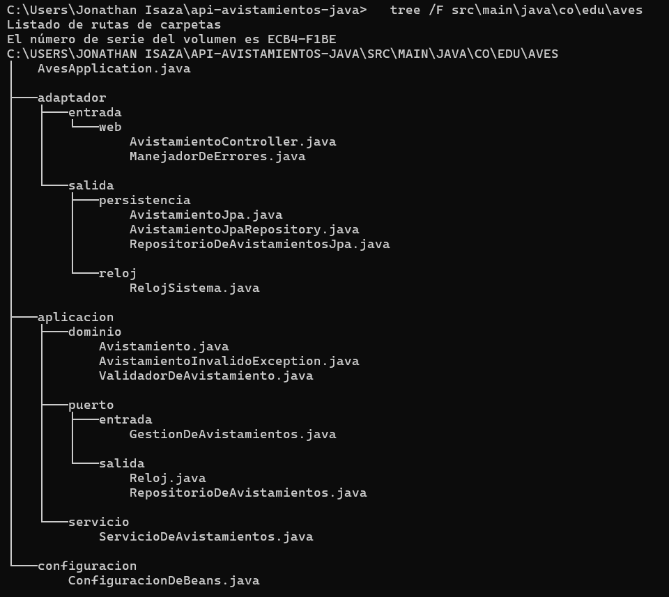
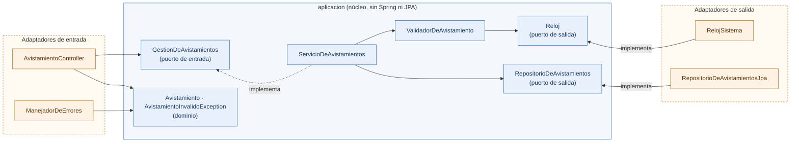
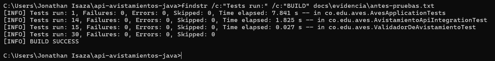
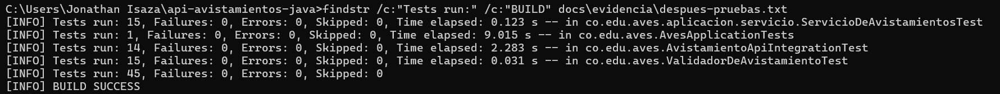

# Taller 5: Clean Architecture y arquitectura hexagonal

11 de noviembre de 2026 · Juan Pablo Moreno Castro

Taller individual de ISW-2 (Universidad El Bosque, miércoles 11 de noviembre de 2026): investigación de tres arquitecturas y refactor de mi API de avistamientos de aves a arquitectura hexagonal, con las 30 pruebas anteriores en verde en cada commit.

| Dato | Valor |
| --- | --- |
| Repositorio | [pabloCastro1532/api-avistamientos-java](https://github.com/pabloCastro1532/api-avistamientos-java) |
| Rama del refactor | [`refactor-arquitectura`](https://github.com/pabloCastro1532/api-avistamientos-java/tree/refactor-arquitectura) |
| Commits de la rama | [historial](https://github.com/pabloCastro1532/api-avistamientos-java/commits/refactor-arquitectura) |
| Arquitectura elegida | Hexagonal (puertos y adaptadores) |

# Parte 1. Investigación

## Pregunta 1

**¿Cuál es ese problema?**

El problema que ve Cockburn es que la lógica de negocio se mezcla con el código de la interfaz de usuario. Por eso la aplicación no se puede probar de forma automática, no se puede ejecutar por lotes y otro programa no puede usarla (Cockburn, 2005). Pasa lo mismo con la base de datos, porque si la lógica depende de ella y el servidor se cae, el trabajo se frena (Cockburn, 2005).

**¿Qué es un puerto y qué es un adaptador en su propuesta?**

Un puerto es el punto por donde la aplicación se comunica con algo externo, y su forma la define el propósito de esa conversación por medio de una API. Un adaptador es el que traduce entre esa API y lo que necesita cada tecnología (Cockburn, 2005). Un mismo puerto puede tener varios adaptadores, como una interfaz gráfica, una prueba automática o una base de datos. En mi API, GestionDeAvistamientos es el puerto y AvistamientoController es el adaptador que convierte una petición HTTP en una llamada a ese puerto.

**¿Por qué dice que hay una simetría entre el lado del usuario y el lado de la base de datos?**

Cockburn dice que los problemas del lado del usuario y del lado de la base de datos tienen la misma causa, que es mezclar la lógica con lo externo. Por eso la diferencia importante no es izquierda contra derecha, sino lo que está dentro contra lo que está fuera de la aplicación (Cockburn, 2005). Entonces el usuario y la base de datos son externos y se conectan de la misma forma, por medio de puertos. La única diferencia es que unos manejan la aplicación y otros son manejados por ella (Cockburn, 2005).

## Pregunta 2

**¿Qué va en cada círculo?**

Son cuatro círculos, uno dentro del otro (Martin, 2012). Al centro van las entidades, que son las reglas de negocio generales. Luego están los casos de uso, que son las reglas propias de la aplicación. Después van los adaptadores de interfaz, como los controladores y los presentadores, que convierten los datos y donde debe quedar el SQL. Por fuera están los frameworks y drivers, como la base de datos y el framework web (Martin, 2012).

**¿Qué dice esa regla sobre la dirección en que puede apuntar el código y qué prohíbe?**

Dice que las dependencias del código solo pueden apuntar hacia adentro, o sea que un círculo interno no puede conocer nada de uno externo (Martin, 2012). Prohíbe que el código de adentro use nombres de clases, funciones o variables de afuera, y también formatos de datos que vengan de afuera, sobre todo de un framework (Martin, 2012). En mi API, una clase de dominio con anotaciones de JPA rompería la regla.

## Pregunta 3

**¿Cómo resuelve Clean Architecture esa contradicción? Explique el mecanismo con un ejemplo.**

El caso de uso necesita guardar, pero no puede conocer la base de datos. Martin lo resuelve con la inversión de dependencias. El caso de uso llama a una interfaz que está en su mismo círculo y el círculo de afuera la implementa, así que en el código la dependencia apunta hacia adentro aunque la ejecución llegue hasta la base de datos (Martin, 2012). Palermo lo plantea igual con los repositorios (Palermo, 2008).

Un ejemplo puede ser en mi API, el servicio que crea un avistamiento llama a la interfaz RepositorioDeAvistamientos, que está en el núcleo. La clase RepositorioDeAvistamientosJpa, que está afuera, la implementa y guarda en H2. En las pruebas puedo usar un repositorio en memoria y todo funciona igual.

## Pregunta 4

**¿Qué tienen en común las tres?**

Las tres buscan separar responsabilidades en capas, con una para las reglas de negocio y otra para las interfaces, y así no depender de los frameworks, de la interfaz ni de la base de datos (Martin, 2012). Palermo dice que la cebolla y la hexagonal comparten la idea de dejar la infraestructura afuera por medio de adaptadores (Palermo, 2008).

**¿Qué cambia de una a otra, el vocabulario, el número de capas o algo más?**

Cambia sobre todo el vocabulario y la cantidad de capas. Cockburn habla de puertos y adaptadores y no define anillos, solo separa dentro y fuera (Cockburn, 2005). Palermo pone el modelo de dominio al centro y deja abierto el número de capas (Palermo, 2008). Martin usa cuatro círculos, aunque dice que pueden ser más, y separa las entidades de los casos de uso (Martin, 2012).

## Pregunta 5

**Mi API es pequeña, con unos pocos endpoints y una regla de validación. ¿Se justifica aplicarle Clean Architecture?**

Para una API tan pequeña como la mía, creo que no se justifica si va a seguir así, pero sí si va a crecer.

El costo es que hay más archivos. En mi API pasé de 9 a 15 archivos y tuve que duplicar la clase Avistamiento, una de dominio y otra de persistencia. Palermo mismo dice que su arquitectura no es apropiada para sitios pequeños, sino para aplicaciones largas y complejas (Palermo, 2008).

El beneficio es que la lógica se puede probar sin la base de datos ni la web (Martin, 2012). En mi API, las 15 pruebas del servicio corrieron en 0,123 segundos y la que arranca Spring tardó 9 segundos. Además, cambiar la base de datos es solo escribir otro adaptador (Martin, 2012 y Palermo, 2008).

# Parte 2. Aplicación

## Qué arquitectura elegí y por qué

Elegí la **arquitectura hexagonal** porque primero mi API tiene exactamente dos lados claros, la web y la base de datos, el vocabulario de puertos y adaptadores describe eso sin forzar nada, segundo la cebolla y Clean Architecture piden más anillos o separar entidades de casos de uso y teniendo encuenta que es solo una regla de negocio esa separación no aporta y tercero la intención de Cockburn de que la aplicación pueda ser manejada por pruebas se cumple de forma directa (Cockburn, 2005): `ServicioDeAvistamientosTest` es un "actor primario" más.

## Estructura de carpetas



## Diagrama de la dirección de las dependencias

Las flechas son dependencias del código fuente: los adaptadores de entrada y de salida apuntan hacia el núcleo (`aplicacion`).



## Cómo fue evolucionando (commits de la rama)

Hice el cambio en este orden: primero el núcleo al lado del código viejo, luego el cambio de los adaptadores, para que las pruebas del taller anterior estuvieran en verde en cada commit.

| # | Commit | Qué cambia | Pruebas |
| --- | --- | --- | --- |
| 0 | Evidencia "antes": pruebas, cobertura y muestra de la API | Se guarda la línea base sin tocar el código | 30 de 30 pasan |
| 1 | Hexagonal 1/3: crear el núcleo (dominio, puertos y casos de uso) | Se agrega `aplicacion/` junto al código viejo; todavía nada lo usa | 30 de 30 pasan |
| 2 | Hexagonal 2/3: adaptadores web, JPA y reloj; configuración de beans | Se crean los adaptadores, se borran las 8 clases viejas y las pruebas pasan a usar el puerto | 30 de 30 pasan |
| 3 | Hexagonal 3/3: pruebas del servicio con fake en memoria | Se agregan 15 pruebas de los casos de uso sin Spring | 45 de 45 pasan |
| 4 | Evidencia "después" y este documento | Salida de pruebas, cobertura y muestra de la API | 45 de 45 pasan |

## Evidencia antes y después

### Pruebas

|  | Antes | Después |
| --- | --- | --- |
| Pruebas totales | 30 | 45 |
| `ValidadorDeAvistamientoTest` | 15 | 15 |
| `AvistamientoApiIntegrationTest` | 14 | 14 |
| `AvesApplicationTests` | 1 | 1 |
| `ServicioDeAvistamientosTest` | no existía | 15 |
| Fallos / errores | 0 / 0 | 0 / 0 |
| Resultado | BUILD SUCCESS | BUILD SUCCESS |

**Antes** del refactor (`mvnw.cmd clean verify`, archivo `antes-pruebas.txt`):



**Después** del refactor (`mvnw.cmd clean verify`, archivo `despues-pruebas.txt`):



Salidas completas en el repositorio: `docs/evidencia/antes-pruebas.txt` y `docs/evidencia/despues-pruebas.txt` (comando: `mvnw.cmd clean verify`). Las 30 pruebas anteriores no cambiaron de lógica: solo cambiaron los `import` y en la de integración el repositorio que usan para preparar datos (ahora el puerto `RepositorioDeAvistamientos` en vez de Spring Data directamente).

### Cobertura (JaCoCo 0.8.15)

|  | Antes | Después |
| --- | --- | --- |
| Instrucciones | 98 % (5 de 270 sin cubrir) | 98 % (5 de 455 sin cubrir) |
| Ramas | 100 % (0 de 16 sin cubrir) | 100 % (0 de 18 sin cubrir) |
| Clases | 7 | 11 |

Lo único sin cubrir en los dos momentos es el método `main` de `AvesApplication`, que solo arranca Spring; no vale la pena una prueba para eso.

**Antes** del refactor (`docs/evidencia/antes-jacoco/index.html`):


**Después** del refactor (`docs/evidencia/despues-jacoco/index.html`):


### La API responde igual

Corrí el mismo script (`docs/evidencia/muestra-api.bat`, 9 peticiones con `curl`) con la API arrancada antes y después, y comparé con `fc docs\evidencia\antes-api.txt docs\evidencia\despues-api.txt`.

| # | Petición | Esperado | Antes | Después |
| --- | --- | --- | --- | --- |
| 1 | `GET /avistamientos` | 200 | 200 | 200 |
| 2 | `POST` válido | 201 | 201 | 201 |
| 3 | `POST` especie de 2 letras | 400, campo `especie` | 400, "La especie debe tener entre 3 y 50 caracteres" | igual |
| 4 | `POST` fecha futura | 400, campo `fecha` | 400, "La fecha no puede ser posterior a hoy" | igual |
| 5 | `POST` con campos faltantes | 400, campo `fecha` | 400, "El campo fecha no puede estar vacío" | igual |
| 6 | `GET /avistamientos/9999` | 404 | 404 | 404 |
| 7 | `PUT /avistamientos/9999` | 404 | 404 | 404 |
| 8 | `DELETE /avistamientos/9999` | 404 | 404 | 404 |
| 9 | `GET /avistamientos/resumen` | 200 | 200 | 200 |

`fc` mostró solo dos diferencias, y ninguna es de comportamiento:

- **El `id` del POST válido** (10 antes, 11 después), porque la base de datos de archivo ya tenía datos y el contador sigue creciendo.
- **El orden de las claves en los mensajes 400** (`campo`/`mensaje`). Un objeto JSON no tiene orden, y el orden lo decide `Map.of`, que varía en cada arranque de la JVM. Pasaba igual en el código original: no lo causó el refactor.

Muestra del POST válido, antes y después:

```
antes:
{"especie":"colibri","fecha":"2026-10-11","id":10,
 "lugar":"Chicaque","observador":"Pablo"}   HTTP 201
después:
{"especie":"colibri","fecha":"2026-10-11","id":11,
 "lugar":"Chicaque","observador":"Pablo"}   HTTP 201
```

## Lo más difícil de separar y por qué

Lo más difícil fue **`Avistamiento`**, porque era dos cosas en una sola clase: el concepto del negocio y la fila de la tabla (`@Entity`, `@Id`, `@GeneratedValue`). En mi código original nunca había notado esa mezcla. Separarlo obligó a decidir qué era de quién: el dominio se quedó con una clase simple (`Avistamiento`) y la persistencia con otra (`AvistamientoJpa`, que conserva `@Table` para no romper los datos que ya había en el archivo de H2), más dos métodos que traducen entre las dos. Es duplicación real, y es el costo más claro del refactor (pregunta 5 de la Parte 1).

## Cómo reproducir

```
git checkout refactor-arquitectura
mvnw.cmd test               (pruebas)
mvnw.cmd clean verify       (pruebas + cobertura)
mvnw.cmd spring-boot:run    (arrancar la API en el puerto 8080)
docs\evidencia\muestra-api.bat   (muestra, con la API arrancada)
```

El reporte de cobertura queda en `target\site\jacoco\index.html`.

## Nota sobre el uso de IA

Usé Claude (Sonnet 5.5) como asistente durante el taller: para proponer el diseño hexagonal, generar el código de los commits 1 a 3 y un borrador de la Parte 2 de este documento. Yo ejecuté cada paso en mi equipo, corrí las pruebas y la cobertura, y revisé los resultados.

# Referencias

- Cockburn, A. (2005). *Hexagonal architecture* (Informe técnico HaT 2005.02). https://alistair.cockburn.us/hexagonal-architecture/ (consultado el 11 de noviembre de 2026).
- Martin, R. C. (2012, 13 de agosto). *The Clean Architecture*. The Clean Code Blog. https://blog.cleancoder.com/uncle-bob/2012/08/13/the-clean-architecture.html (consultado el 11 de noviembre de 2026).
- Palermo, J. (2008, 29 de julio). *The Onion Architecture (part 1)*. Programming with Palermo. https://jeffreypalermo.com/2008/07/the-onion-architecture-part-1/ (consultado el 11 de noviembre de 2026).
